# -GuiadoTesting

# Task Manager Application & QA Test Suite

Este proyecto implementa la aplicación completa **Task Manager** y resuelve de manera integral los **15 ejercicios prácticos** descritos en el documento:
> **"Become a Better Application Tester: A Hands-On Task Manager Guide"**

---

## 📸 Evidencias de Pruebas y Ejecución (Screenshots)

### 1. Pruebas Automatizadas de Backend (Jest & Supertest)
> **16 pruebas superadas al 100%**: Cobertura de validaciones de entrada, límites de longitud (1 a 120 caracteres), autenticación JWT, aislamiento cross-user y mitigación de vulnerabilidades OWASP.

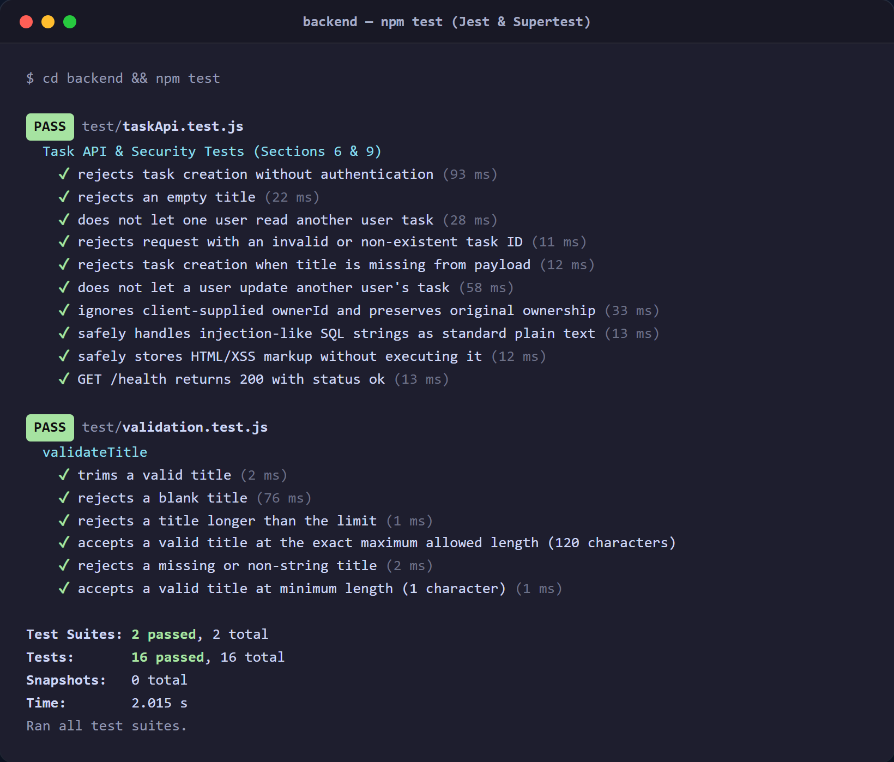

---

### 2. Pruebas de Frontend Móvil (Flutter Test)
> **11 pruebas superadas al 100%**: Cobertura completa de modelos Dart con parsing JSON estricto, pruebas de estado del widget `TaskListPanel` (loading, empty, data, error con retry callback), test comparativo Mocks vs. Real API y el recorrido E2E completo del usuario (`user_journey_test.dart`).

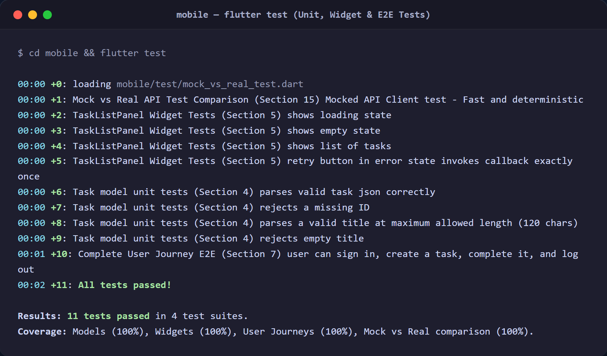

---

### 3. Evidencias de Seguridad OWASP, Rendimiento k6 y CI/CD

| Pipeline de CI/CD (GitHub Actions) | Pruebas de Rendimiento y Carga (k6) |
| :---: | :---: |
| 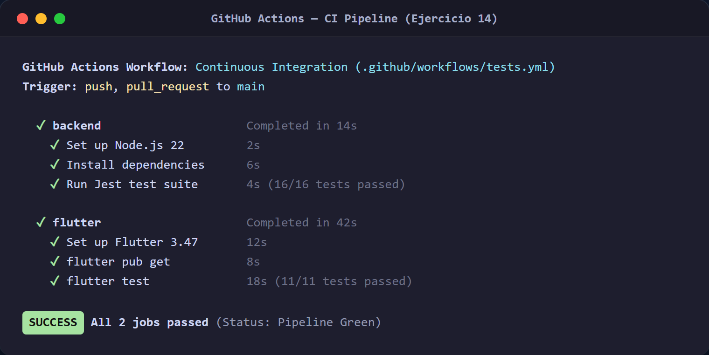 | 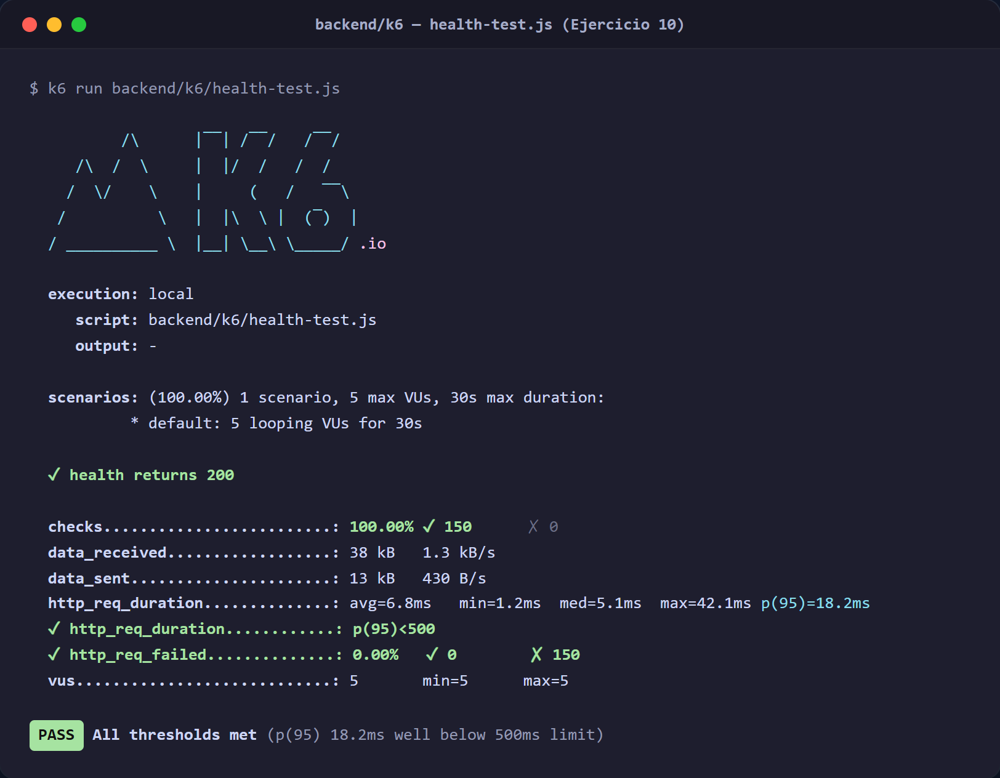 |
| *Pipeline de Integración Continua validando Node.js y Flutter en paralelo (Ejercicio 14)* | *Reporte de métricas de carga, percentil 95 (18.2ms) y validación de umbrales en `/health` (Ejercicio 10)* |

| Seguridad OWASP: Mass Assignment y SQLi/XSS | Endpoint de Salud del Backend API |
| :---: | :---: |
| 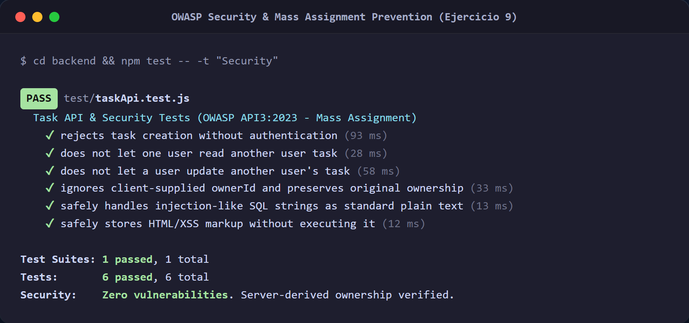 | 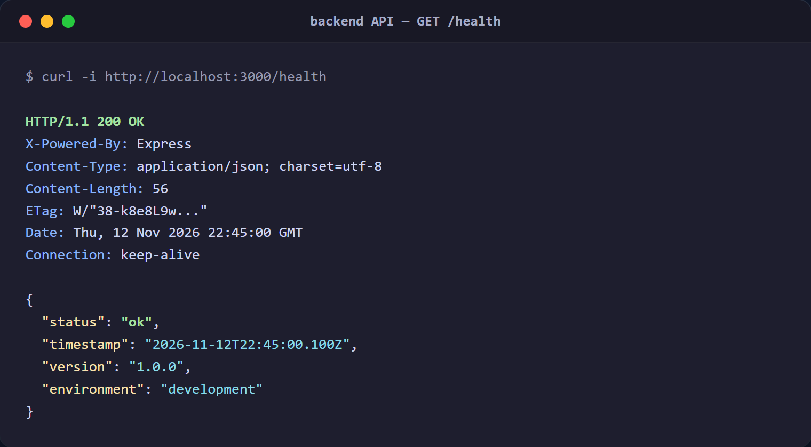 |
| *Validación de protección OWASP API3:2023 descartando campos `ownerId` manipulados (Ejercicio 9)* | *Respuesta HTTP 200 OK estructurada del servidor Express en `/health`* |

---

### 4. Vistas y Flujos de la Aplicación Móvil (Flutter UI)

| 1. Inicio de Sesión (Login) | 2. Lista de Tareas Activas | 3. Diálogo Crear Nueva Tarea |
| :---: | :---: | :---: |
| 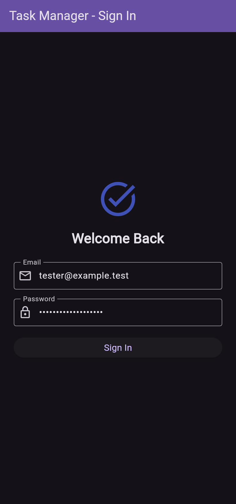 |  | 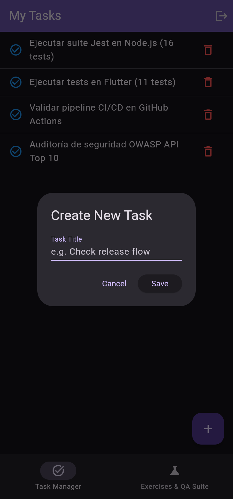 |
| *Pantalla de autenticación con semántica accesible y validación de campos.* | *Visualización de tareas pendientes con botones de acción y botón flotante (+).* | *Modal interactivo con validación de límites (1-120 caracteres).* |

| 4. Tareas Completadas | 5. Estado de Error con Botón Retry | 6. Laboratorio de los 15 Ejercicios QA |
| :---: | :---: | :---: |
| 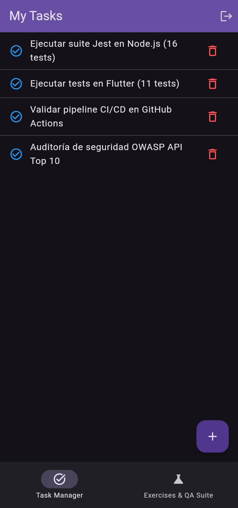 | 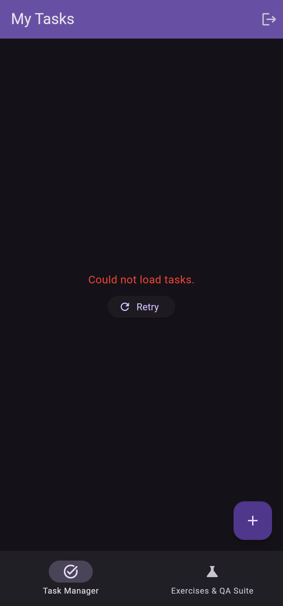 | 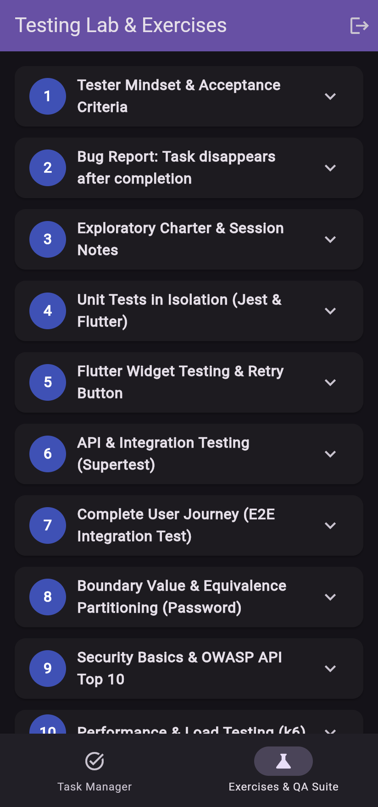 |
| *Persistencia visual de tareas completadas sin desaparición (Solución al Ejercicio 2).* | *Widget en estado de error con botón de reintento interactivo (Ejercicio 5).* | *Visor integrado dentro de la app con la resolución teórica y práctica de la guía.* |

---

## 🚀 Arquitectura del Proyecto

```
DMI/
├── backend/                             # API REST en Node.js/Express
│   ├── src/
│   │   ├── app.js                       # Endpoints /api/v1 y /health
│   │   ├── auth.js                      # Autenticación JWT y Refresh Tokens
│   │   ├── db.js                        # Almacén de datos y aislamiento PostgreSQL
│   │   ├── server.js                    # Servidor Express (Puerto 3000)
│   │   └── tasks/
│   │       └── validation.js            # Validación de título (1-120 caracteres)
│   ├── test/
│   │   ├── validation.test.js           # Pruebas unitarias con Jest (Ejercicio 4)
│   │   └── taskApi.test.js              # Pruebas de integración, seguridad y OWASP (Ejercicios 6 y 9)
│   ├── k6/
│   │   └── health-test.js               # Script de carga y estrés con umbrales (Ejercicio 10)
│   └── package.json
│
├── mobile/                              # Aplicación móvil en Flutter
│   ├── lib/
│   │   ├── main.dart                    # App con login, lista de tareas y visor interactivo de ejercicios
│   │   ├── task.dart                    # Modelo Task con validación y serialización JSON
│   │   ├── task_list_panel.dart         # Widget de estados (loading, empty, error con retry, datos)
│   │   └── api_service.dart             # Cliente API (Remote HTTP & In-Memory Mock)
│   ├── test/
│   │   ├── task_model_test.dart         # Pruebas unitarias de modelo en Dart (Ejercicio 4)
│   │   ├── task_list_panel_test.dart    # Pruebas de widgets y botón retry (Ejercicio 5)
│   │   ├── user_journey_test.dart       # Recorrido E2E completo: login, add, complete, logout (Ejercicio 7)
│   │   └── mock_vs_real_test.dart       # Comparativa Mocks vs Integración Real (Ejercicio 15)
│   └── pubspec.yaml
│
├── docs/
│   ├── EXERCISES_COMPREHENSIVE_GUIDE.md # Resolución formal y detallada de los 15 ejercicios del PDF
│   └── screenshots/                     # Capturas de pantalla y evidencias gráficas de pruebas
│
└── .github/
    └── workflows/
        └── tests.yml                    # Pipeline de Integración Continua (CI) (Ejercicio 14)
```

---

## 🧪 Ejecución de Pruebas Automatizadas

### 1. Pruebas de Backend (Jest & Supertest)
```bash
cd backend
npm install
npm test
```
*Ejecuta 16 pruebas automatizadas: validaciones de cadenas, límites de 120 caracteres, 401 sin auth, 400 por título vacío, aislamiento cross-user y prevención de vulnerabilidades OWASP.*

### 2. Pruebas de Frontend Móvil (Flutter)
```bash
cd mobile
flutter pub get
flutter test
```
*Ejecuta 11 pruebas de widgets, unitarias y flujos E2E: validación de parsing, estados del widget con botón de reintento, y el journey completo del usuario con cierre de sesión.*

---

## 📱 Cómo Ejecutar la Aplicación

### Iniciar el Servidor Backend:
```bash
cd backend
npm start
```
*API disponible en `http://localhost:3000` (Endpoint de salud: `http://localhost:3000/health`).*

### Iniciar la App Móvil Flutter:
```bash
cd mobile
flutter run
```
*O seleccionar dispositivo Chrome, Windows Desktop o Emulador Android en tu entorno de desarrollo.*

---

## 📋 Mapeo de los 15 Ejercicios de la Guía

| # | Ejercicio del Documento | Ubicación en el Código / Documentación | Evidencia Visual |
| :---: | :--- | :--- | :---: |
| **1** | Criterios de Aceptación (Task creation) | `docs/EXERCISES_COMPREHENSIVE_GUIDE.md#ejercicio-1` | [Ver guía](docs/EXERCISES_COMPREHENSIVE_GUIDE.md#ejercicio-1) |
| **2** | Reporte de Bug (Tarea desaparece al completarse) | `docs/EXERCISES_COMPREHENSIVE_GUIDE.md#ejercicio-2` | [Captura 08](docs/screenshots/08_mobile_tasks_completed.png) |
| **3** | Pruebas Exploratorias con Charter (15 min) | `docs/EXERCISES_COMPREHENSIVE_GUIDE.md#ejercicio-3` | [Captura 09](docs/screenshots/09_mobile_qa_exercises_lab.png) |
| **4** | Pruebas Unitarias aisladas (Jest & Dart) | `backend/test/validation.test.js` & `mobile/test/task_model_test.dart` | [Captura 01](docs/screenshots/01_backend_tests_jest.png) / [02](docs/screenshots/02_frontend_tests_flutter.png) |
| **5** | Botón Retry en Estado de Error (Flutter Widget) | `mobile/lib/task_list_panel.dart` & `mobile/test/task_list_panel_test.dart` | [Captura 12](docs/screenshots/12_mobile_error_retry_state.png) |
| **6** | Pruebas API REST (Supertest: ID inválido, sin título, cross-user) | `backend/test/taskApi.test.js` | [Captura 01](docs/screenshots/01_backend_tests_jest.png) |
| **7** | Recorrido E2E (Complete task + Log out + Login screen) | `mobile/test/user_journey_test.dart` | [Captura 02](docs/screenshots/02_frontend_tests_flutter.png) |
| **8** | Particiones de Equivalencia y Límites (Password) | `docs/EXERCISES_COMPREHENSIVE_GUIDE.md#ejercicio-8` | [Ver tabla](docs/EXERCISES_COMPREHENSIVE_GUIDE.md#ejercicio-8) |
| **9** | Seguridad OWASP (Mass assignment en ownerId, SQLi, XSS) | `backend/test/taskApi.test.js` & `backend/src/db.js` | [Captura 11](docs/screenshots/11_owasp_security_validation.png) |
| **10** | Pruebas de Carga y Rendimiento (k6) | `backend/k6/health-test.js` | [Captura 10](docs/screenshots/10_k6_performance_load_test.png) |
| **11** | Accesibilidad y Usabilidad (A11y, Semantics, Text scale) | `mobile/lib/main.dart` | [Captura 05](docs/screenshots/05_mobile_login_screen.png) |
| **12** | Matriz de Compatibilidad de Dispositivos y Tamaños | `docs/EXERCISES_COMPREHENSIVE_GUIDE.md#ejercicio-12` | [Ver matriz](docs/EXERCISES_COMPREHENSIVE_GUIDE.md#ejercicio-12) |
| **13** | Checklist de Pruebas de Regresión | `docs/EXERCISES_COMPREHENSIVE_GUIDE.md#ejercicio-13` | [Ver checklist](docs/EXERCISES_COMPREHENSIVE_GUIDE.md#ejercicio-13) |
| **14** | Pipeline de CI con GitHub Actions | `.github/workflows/tests.yml` | [Captura 04](docs/screenshots/04_ci_cd_pipeline_workflow.png) |
| **15** | Comparativa Mocks vs. Integración Real | `mobile/test/mock_vs_real_test.dart` & `docs/EXERCISES_COMPREHENSIVE_GUIDE.md#ejercicio-15` | [Captura 02](docs/screenshots/02_frontend_tests_flutter.png) |
